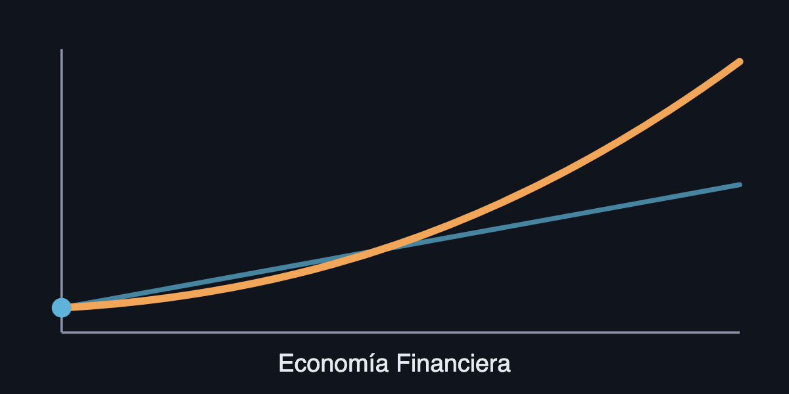

# Economía Financiera

Curso interactivo, en español y al estilo 3Blue1Brown, de Economía Financiera. Primero ves la imagen, después la fórmula, y puedes mover los deslizadores tú mismo.

[Abrir el curso](https://jesusvillota.github.io/economia-financiera/) · [Sesiones de problemas](https://jesusvillota.github.io/economia-financiera/sesiones/) · [Glosario](https://jesusvillota.github.io/economia-financiera/glosario/)

## Qué es

- **21 capítulos en cinco partes**: valor del dinero en el tiempo; acciones y empresas; carteras y CAPM; mercados; renta fija y derivados.
- **Cuatro sesiones de problemas**: ejercicios de datos variables, pistas graduales y solución paso a paso.
- **Preparación del examen final**: ejercicios mixtos en tres niveles de dificultad.

Empieza por el capítulo 1 y sigue los requisitos indicados en el índice. Usa las sesiones para practicar y el glosario para consultar términos y símbolos.

## Para quién

Estudiantes de un curso de Economía Financiera. No hace falta cuenta ni servidor: es un sitio estático.

Modelo: [options-explained](https://github.com/jesusvillota/options-explained). La profundidad en opciones se enlaza allí.

## Cómo ejecutarlo

1. `npm ci`
2. `npm run dev` (servidor local)
3. `npm test && npm run build` (pruebas y compilación)
4. `npm run preview` (ver el sitio compilado)
5. `npx playwright install chromium` (preparar el navegador para las capturas, una sola vez)
6. `npm run screenshots home` (revisar la portada en ambos temas y tamaños; requiere `dist/`)

Las capturas quedan en `screenshots/`. El comando falla si encuentra errores de consola, fórmulas KaTeX o desbordamiento horizontal.
`npm run screenshots dev` revisa la página de componentes. Sin filtro, `npm run screenshots` revisa todo el curso.

Las páginas del curso incluyen descripción, URL canónica y etiquetas Open Graph y Twitter. Las descripciones de capítulos y sesiones usan su campo `summary`.
La tarjeta social `public/og.png` (1200 × 600) procede de `public/course-preview.svg`.
La compilación genera `dist/404.html` y `dist/sitemap-index.xml`; el mapa excluye la página de desarrollo y la de error.

Más detalle del proceso en `CLAUDE.md` y `docs/STYLE_GUIDE.md`. El plan vive en `goals/course-site/`.

## Despliegue

URL pública: <https://jesusvillota.github.io/economia-financiera/>.

1. Usa Node.js 22 (versión 22.12.0 o posterior de la rama 22), como el flujo de despliegue.
2. Ejecuta `npm ci && npm test && npm run build`. El sitio compilado queda en `dist/`.
3. En GitHub, selecciona **Settings → Pages → Build and deployment → Source: GitHub Actions**.
4. Publica los cambios en `main`. El flujo `.github/workflows/ci.yml` compila y despliega `dist/` en Pages.

Astro usa `site: 'https://jesusvillota.github.io'` y `base: '/economia-financiera'`.
El despliegue usa el artefacto de Pages, sin Jekyll; no necesita `.nojekyll`.

## Licencia

Código: MIT (`LICENSE`). Contenido: CC BY 4.0 (`LICENSE-CONTENT.md`).
