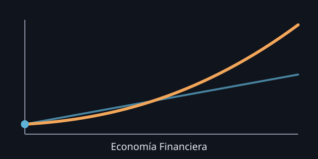

# Economía Financiera

Curso interactivo, en español y al estilo 3Blue1Brown, de Economía Financiera. Primero ves la imagen, después la fórmula, y puedes mover los deslizadores tú mismo.

## Qué es

- **Capítulos** (21, en cinco partes): valor del dinero en el tiempo, valoración, carteras y CAPM, mercados, renta fija y derivados.
- **Sesiones de problemas**: una pista aparte, con ejercicios de datos variables, pistas graduales y solución paso a paso.

## Para quién

Estudiantes de un curso de Economía Financiera. No hace falta cuenta ni servidor: es un sitio estático.

Modelo: [options-explained](https://github.com/jesusvillota/options-explained). La profundidad en opciones se enlaza allí.

## Cómo ejecutarlo

1. `npm ci`
2. `npm run dev` (servidor local)
3. `npm test && npm run build` (pruebas y compilación)
4. `npm run preview` (ver el sitio compilado)

Más detalle del proceso en `CLAUDE.md` y `docs/STYLE_GUIDE.md`. El plan vive en `goals/course-site/`.

## Licencia

Código: MIT (`LICENSE`). Contenido: CC BY 4.0 (`LICENSE-CONTENT.md`).
